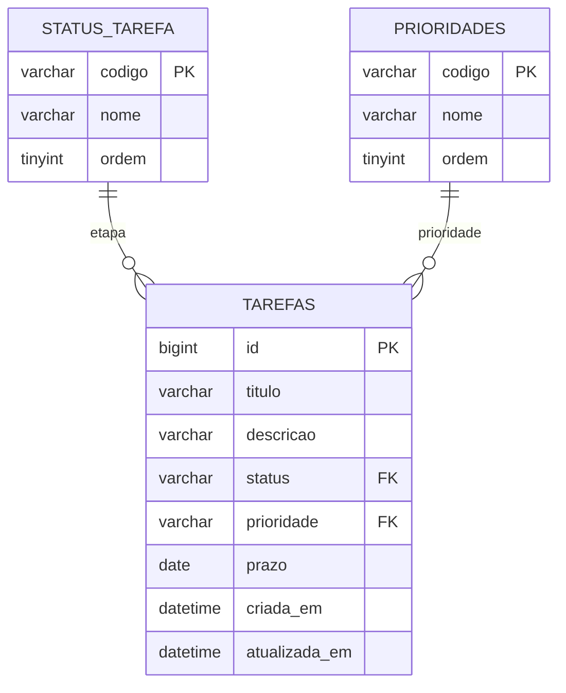

# Banco MySQL Kanban

Conecte ao servidor MySQL 8 em `localhost:3306`. A porta pertence ao servidor; o nome do banco é `kanban`.

## Executar no MySQL Workbench

1. Abra sua conexão local (host `localhost`, porta `3306`).
2. Abra e execute todo o arquivo `01_schema.sql`.
3. Execute `02_consultas.sql` para conferir as tabelas e os relacionamentos.

O usuário precisa de permissão para criar o banco e as tabelas. Os scripts não armazenam credenciais.

## Executar no DBeaver

Abra `01_schema.sql` na conexão MySQL e use **Alt+X → Executar script SQL**. O editor separa os comandos pelos pontos e vírgulas e os executa em sequência.

Para executar com **Ctrl+Enter**, selecione somente um comando completo de cada vez, incluindo o ponto e vírgula final. Selecionar vários comandos e enviá-los como uma única instrução pode causar erro 1064 na primeira instrução seguinte, como `INSERT INTO status_tarefa`.

Referência: https://dbeaver.com/docs/dbeaver/SQL-Execution/

## Executar pelo cliente MySQL no Windows

Na raiz do projeto:

```powershell
& 'C:\Program Files\MySQL\MySQL Server 8.0\bin\mysql.exe' --host=127.0.0.1 --port=3306 --user=root --password --default-character-set=utf8mb4 --execute="source database/01_schema.sql"
```

O cliente solicita a senha sem colocá-la no comando. Substitua `root` pelo seu usuário administrativo, se necessário.

## Relacionamentos



Cada etapa e prioridade pode ser usada por várias tarefas. Cada tarefa tem exatamente uma etapa e uma prioridade. As chaves estrangeiras impedem remover uma etapa ou prioridade usada por tarefas.

O script inclui os três status e as três prioridades aceitos pelo Java. Não insere tarefas de exemplo. `CREATE TABLE IF NOT EXISTS` permite executar novamente em uma estrutura já compatível; não migra uma tabela antiga com estrutura diferente. Para banco existente, confira `SHOW CREATE TABLE tarefas` antes de aplicar mudanças.

## Iniciar a aplicação com este banco

No perfil MySQL, a aplicação cria automaticamente a tabela de histórico ausente antes da validação do Hibernate. Isso exige permissão `CREATE` no banco. Como alternativa, um administrador pode executar `03_historico.sql` manualmente e desabilitar essa inicialização com `SPRING_SQL_INIT_MODE=never`. Instalações novas pelo `01_schema.sql` já incluem a tabela. Ela se relaciona com tarefas por `tarefa_id`; quando uma tarefa é excluída, o histórico permanece com os dados e o ID original. Os eventos são gravados na mesma transação da alteração, sem registrar salvamentos que não mudam nenhum campo.

O histórico começa após a instalação. Edições feitas diretamente no MySQL não passam pela API e não são registradas. Não há identificação de usuário nesta versão sem login.

No VS Code, escolha **Kanban — Front + Back (MySQL)** e pressione F5. Informe um usuário que tenha acesso ao banco e sua senha nos campos solicitados. As credenciais ficam na execução, sem serem gravadas no launch.json.

Pelo terminal:

```powershell
node scripts/start.mjs --mysql
```

O inicializador pede o usuário e a senha no terminal quando as variáveis `DB_USER` e `DB_PASSWORD` não estão configuradas. A senha não aparece enquanto você digita; confirme com Enter. As credenciais são passadas ao processo do Maven por variáveis de ambiente, sem gravação em arquivos ou inclusão no comando.

A aplicação usa `jdbc:mysql://localhost:3306/kanban` e verifica a estrutura existente. O perfil `demo` continua usando H2, independente do MySQL; dados do demo não são copiados automaticamente.
